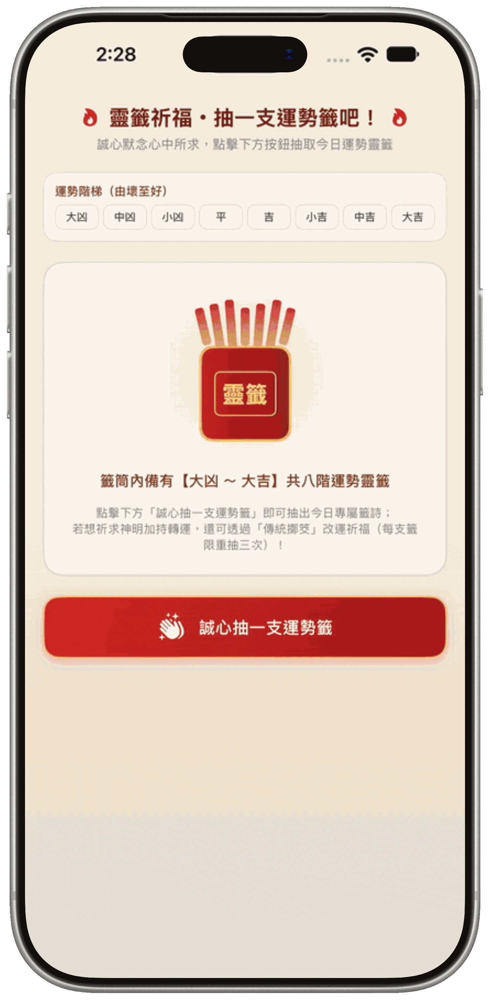
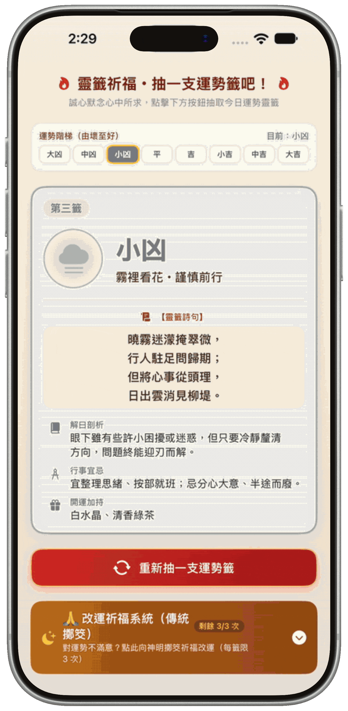
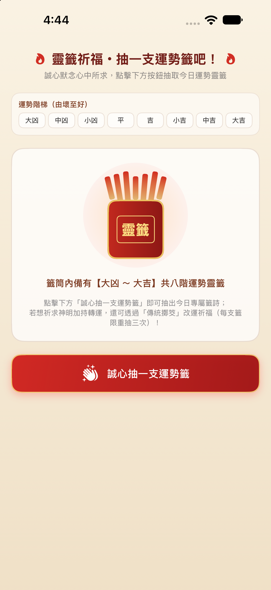
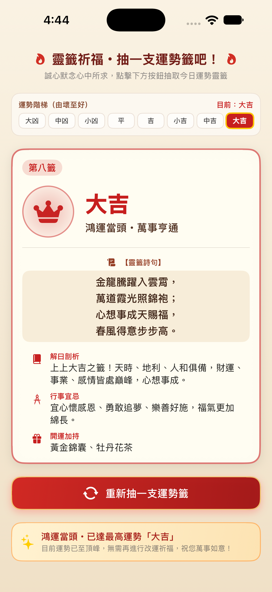
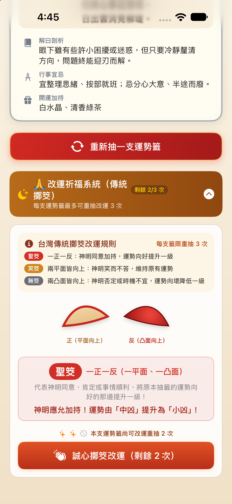

<div align="center">

# 🏮 Draw a Fortune Slip! ・ 抽一支運勢籤吧！

**A Traditional Taiwanese Temple Fortune-Telling & Poe Divination (擲筊) App Built with SwiftUI**  
**結合臺灣傳統宮廟靈籤與「擲筊改運祈福」互動體驗的 SwiftUI 應用程式**

[](https://developer.apple.com/ios/)
[](https://swift.org/)
[](https://developer.apple.com/xcode/swiftui/)
[](https://developer.apple.com/xcode/)
[](https://en.wikipedia.org/wiki/Kau_chim)

<br />

### 🌐 Language / 語言切換

[**🇺🇸 English**](#-english-version) &nbsp;｜&nbsp; [**🇹🇼 繁體中文**](#-繁體中文版)

</div>

---

<a id="english"></a>
<a id="-english-version"></a>

# 🇺🇸 English Version

> 📖 **[Switch to Traditional Chinese / 切換至繁體中文 🇹🇼](#-繁體中文版)**

## ✨ Overview

**Draw a Fortune Slip! (抽一支運勢籤吧！)** brings the warm, ceremonial atmosphere of traditional Taiwanese temple fortune-telling (*Kau Chim* / 靈籤) and moon-block divination (*Jiaobei* / 擲筊) directly to iOS.

Designed entirely with native **SwiftUI** vector graphics, custom geometric shapes (`Shape`), and spring animations—without relying on external image assets—users can calm their minds, draw one of **8 ranked fortune slips** (ranging from *Great Misfortune* to *Great Blessing*), read classical seven-character quatrains with modern interpretations, and even pray to the deities by **throwing crescent moon blocks (擲筊)** up to 3 times per slip to turn their luck around!

---

## 📸 Screenshots & Demo GIFs

### 🎬 App Operation Demos (GIF)

| 🎋 1. Drawing a Fortune Slip (`demo_draw.gif`) | 🙏 2. Jiaobei Luck-Changing (`demo_jiaobei.gif`) |
| :---: | :---: |
|  |  |
| *Shaking the bamboo cylinder & drawing Great Blessing (大吉)* | *Throwing crescent moon blocks (擲筊) to upgrade fortune rank* |

### 📱 App Screenshots

| 🎋 1. Fortune Cylinder (Home) | 👑 2. Fortune Slip & Great Blessing | 🙏 3. Jiaobei Divination System |
| :---: | :---: | :---: |
|  |  |  |
| *Warm rice-paper theme, 8-tier fortune ladder & custom bamboo cylinder* | *Classical poem, detailed breakdown, advice, lucky items & peak banner* | *Taiwanese Poe divination rules, crescent moon blocks & luck upgrade* |

---

## 🌟 Key Features

- 🏮 **Authentic Temple Aesthetics**: Warm Xuan-paper (宣紙) gradients, vermilion red & gold-trimmed accents, and serif typography inspired by Taiwanese temple plaques and fortune slips.
- 📊 **8-Tier Fortune Ladder**: Real-time visual progress bar displaying all 8 ranks from left to right (`大凶` → `中凶` → `小凶` → `平` → `吉` → `小吉` → `中吉` → `大吉`), highlighting your current fortune level with spring animations.
- 📜 **Rich Fortune Slip Cards**:
  - **Slip Number & Rank Seal**: Dynamic SF Symbols with pulsing effects (`symbolEffect(.pulse)`).
  - **Classical Poetry (靈籤詩句)**: Traditional four-line, seven-character poems formatted in serif type.
  - **Detailed Breakdown (解曰剖析)**: Clear explanation of your current luck and timing.
  - **Do's & Don'ts (行事宜忌)**: Actionable guidance and precautions.
  - **Lucky Charms (開運加持)**: Curated lucky items and teas to boost your fortune.
- 🙏 **Traditional Taiwanese Jiaobei (擲筊) Luck-Changing System**:
  - Not satisfied with your draw? Expand the **Prayer & Jiaobei Panel** to ask the deities for a blessing!
  - Limited to **3 throws per fortune slip**, complete with visual sparkle/lock indicators (`sparkles` / `circle.slash`).
  - Automatically tracks and displays your fortune transition history (e.g., `~~中凶~~ → 小凶`) on the slip card.
  - Displays a special golden celebration banner once you reach the highest rank (**大吉 Great Blessing**).
- 🎨 **100% Pure SwiftUI Vector Graphics**:
  - Custom `EmptyCylinderPlaceholderView` drawing 7 fanned bamboo sticks inside a gold-trimmed vermilion cylinder.
  - Custom `CrescentBlockShape` using quadratic Bézier curves (`addQuadCurve`) to render 3D-shaded flat and convex moon blocks (`SingleJiaobeiBlockView`).

---

## 🎲 Fortune Ladder & Jiaobei Rules

### 📈 The 8 Fortune Ranks

| Rank | Slip # | Level | Title | SF Symbol | Lucky Items |
| :---: | :---: | :---: | :--- | :---: | :--- |
| **0** | 第一籤 | 🌩️ **大凶** (Great Misfortune) | 烏雲蔽日・靜守待時 | `cloud.bolt.rain.fill` | 平安護身符、溫熱茶飲 |
| **1** | 第二籤 | ❄️ **中凶** (Moderate Misfortune) | 逆水行舟・步步為營 | `wind.snow` | 檀香木飾品、深色筆記本 |
| **2** | 第三籤 | 🌫️ **小凶** (Minor Misfortune) | 霧裡看花・謹慎前行 | `cloud.fog.fill` | 白水晶、清香綠茶 |
| **3** | 第四籤 | 🍃 **平** (Neutral / Peaceful) | 風平浪靜・安穩自在 | `leaf.fill` | 竹製書籤、素色帆布袋 |
| **4** | 第五籤 | 🌅 **吉** (Good Fortune) | 春風拂柳・漸入佳境 | `sun.and.horizon.fill` | 紅線手環、柑橘香氛 |
| **5** | 第六籤 | 🐦 **小吉** (Minor Blessing) | 喜鵲登枝・小有斬獲 | `bird.fill` | 金色鑰匙圈、桂花糕點 |
| **6** | 第七籤 | ✨ **中吉** (Moderate Blessing) | 紫氣東來・貴人相扶 | `sparkles` | 紫晶吊墜、紅玉紅茶 |
| **7** | 第八籤 | 👑 **大吉** (Great Blessing) | 鴻運當頭・萬事亨通 | `crown.fill` | 黃金錦囊、牡丹花茶 |

### 🌙 Taiwanese Jiaobei (擲筊) Divination Rules

| Result | Block Orientation | Deity's Answer | Effect on Fortune |
| :---: | :--- | :--- | :--- |
| 🔴 **聖筊 (Sheng Jiao)** | **1 Flat + 1 Convex** (一正一反) | Divine approval & blessing | ⬆️ **Upgrades** fortune by **+1 rank** (up to `大吉`) |
| 🟡 **笑筊 (Xiao Jiao)** | **2 Flat Sides Up** (兩平面皆向上) | The deity smiles without answering | ➡️ **Maintains** current fortune rank |
| ⚫ **無筊 (Wu Jiao)** | **2 Convex Sides Up** (兩凸面皆向上) | Divine disapproval or wrong timing | ⬇️ **Downgrades** fortune by **-1 rank** (down to `大凶`) |

---

## 🛠️ Tech Stack & Architecture

- **Framework**: SwiftUI (`iOS 17.0+`)
- **State Management**: Declarative `@State` properties (`currentIndex`, `previousLevelName`, `isShakingCylinder`, `showPraySystem`, `isThrowingBlocks`, `lastJiaobeiResult`, `remainingRedrawCount`)
- **Custom Geometry & Drawing**:
  - `CrescentBlockShape`: Conforms to `Shape`, drawing authentic crescent moon divination blocks with dual quadratic Bézier curves.
  - `LinearGradient` & `RadialGradient`: Used for 3D wood-grain and red-lacquer lighting effects.
- **Animations & Transitions**:
  - `.spring(response:dampingFraction:)` for card reveals, ladder scaling, and Jiaobei results.
  - `.easeInOut.repeatCount(3, autoreverses: true)` for cylinder shaking.
  - `.symbolEffect(.pulse, options: .repeating)` for dynamic SF Symbol badges.

---

## 🚀 Getting Started

1. **Clone the repository**:
   ```bash
   git clone https://github.com/your-username/draw-a-fortune-slip.git
   ```
2. **Open in Xcode**:
   Double-click `抽一支運勢籤吧！.xcodeproj` to open the project in **Xcode 15.0** or later.
3. **Run the App**:
   Select an iPhone Simulator (e.g., **iPhone 16 Pro**) and press `Cmd + R` to build and run.

---

<br />

<a id="traditional-chinese"></a>
<a id="-繁體中文版"></a>

# 🇹🇼 繁體中文版

> 📖 **[Switch to English Version / 切換至英文版 🇺🇸](#-english-version)**

## ✨ 專案簡介

**《抽一支運勢籤吧！》** 是一款充滿臺灣傳統宮廟文化氛圍的 **SwiftUI** 互動求籤與擲筊祈福 App。

全專案採用純 **SwiftUI 原生繪圖元件**、自訂幾何形狀（`Shape`）與流暢的彈簧動畫打造，無須依賴外部圖片素材。使用者可以在溫暖的宣紙漸層與朱紅鑲金視覺設計中，誠心抽取 **【大凶 ～ 大吉】共八階運勢靈籤**，品讀七言絕句籤詩、解曰剖析、行事宜忌與開運加持小物；若對抽出的運勢不滿意，還能展開 **「改運祈福系統（傳統擲筊）」**，向神明誠心擲筊（每支籤限重抽 3 次），體驗臺灣在地「聖筊升運、笑筊維持、無筊降運」的趣味文化！

---

## 📸 畫面截圖與操作 GIF

### 🎬 操作示範 GIF

| 🎋 1. 搖動籤筒與抽中大吉 (`demo_draw.gif`) | 🙏 2. 傳統擲筊改運升階 (`demo_jiaobei.gif`) |
| :---: | :---: |
|  |  |
| *搖動竹籤筒抽出「第八籤・大吉」與攻頂金色賀詞* | *展開改運祈福系統，擲出聖筊／笑筊／無筊即時升降運勢* |

### 📱 應用程式截圖

| 🎋 1. 靈籤筒待機首頁 | 👑 2. 靈籤結果與大吉賀詞 | 🙏 3. 傳統擲筊改運系統 |
| :---: | :---: | :---: |
|  |  |  |
| *溫潤宣紙漸層背景、八階運勢階梯與純 SwiftUI 繪製靈籤筒* | *傳統七言籤詩、解曰剖析、行事宜忌、開運小物與大吉賀詞* | *臺灣傳統擲筊規則說明、弦月形雙筊杯視覺與改運升降提示* |

---

## 🌟 核心功能特色

- 🏮 **傳統宮廟美學設計**：採用溫潤宣紙漸層背景、硃砂紅與琥珀金配色，搭配襯線字體（`.serif`）呈現莊重而溫暖的宮廟靈籤質感。
- 📊 **八階運勢階梯進度條**：由左至右即時顯示 `大凶` → `中凶` → `小凶` → `平` → `吉` → `小吉` → `中吉` → `大吉` 共 8 個等級，抽中或改運後會以彈簧動畫放大高亮當前位階。
- 📜 **精緻靈籤結果卡片（`FortuneSlipCardView`）**：
  - **籤號與改運軌跡**：頂部顯示籤號膠囊標籤，若經過擲筊改運，右上角會即時記錄變化軌跡（如：`~~中凶~~ → 小凶`）。
  - **動態呼吸印章**：搭配 Apple SF Symbols 與 `.symbolEffect(.pulse)` 呼吸光暈特效。
  - **靈籤詩句**：原創四句七言絕句籤詩，置中襯線排版。
  - **全方位運勢指南**：包含 **「📖 解曰剖析」**、**「🧭 行事宜忌」** 與 **「🎁 開運加持」** 三大實用建議。
- 🙏 **臺灣傳統擲筊改運系統**：
  - 抽出非「大吉」的運勢籤時，可展開 **「改運祈福系統（傳統擲筊）」** 向神明祈求轉運。
  - **每支籤限重抽改運 3 次**：配備星芒（`sparkles`）與禁用（`circle.slash`）視覺化次數指示器，次數用盡後按鈕自動鎖定反灰。
  - **攻頂「大吉」專屬祝賀**：當抽中或透過聖筊晉升至最高運勢「大吉」時，自動收起擲筊面板並展示金色祝賀橫幅。
- 🎨 **100% 純程式碼幾何繪圖**：
  - **竹籤與靈籤筒（`EmptyCylinderPlaceholderView`）**：以扇形旋轉排列的 7 支紅頭竹籤搭配硃紅鑲金籤筒，抽籤時具備搖晃動畫。
  - **弦月形雙筊杯（`CrescentBlockShape` & `SingleJiaobeiBlockView`）**：使用二次貝茲曲線（`addQuadCurve`）描繪雙弧度筊杯，並以線性／放射漸層精準區分「正（淺木紋平面向上）」與「反（立體朱漆凸面向上）」。

---

## 🎲 八階運勢一覽與擲筊規則

### 📈 八階運勢靈籤總表

| 階梯索引 | 籤號 | 運勢等級 | 籤題 | 代表圖示 (SF Symbols) | 開運加持小物 |
| :---: | :---: | :---: | :--- | :---: | :--- |
| **0** | 第一籤 | 🌩️ **大凶** | 烏雲蔽日・靜守待時 | `cloud.bolt.rain.fill` | 平安護身符、溫熱茶飲 |
| **1** | 第二籤 | ❄️ **中凶** | 逆水行舟・步步為營 | `wind.snow` | 檀香木飾品、深色筆記本 |
| **2** | 第三籤 | 🌫️ **小凶** | 霧裡看花・謹慎前行 | `cloud.fog.fill` | 白水晶、清香綠茶 |
| **3** | 第四籤 | 🍃 **平** | 風平浪靜・安穩自在 | `leaf.fill` | 竹製書籤、素色帆布袋 |
| **4** | 第五籤 | 🌅 **吉** | 春風拂柳・漸入佳境 | `sun.and.horizon.fill` | 紅線手環、柑橘香氛 |
| **5** | 第六籤 | 🐦 **小吉** | 喜鵲登枝・小有斬獲 | `bird.fill` | 金色鑰匙圈、桂花糕點 |
| **6** | 第七籤 | ✨ **中吉** | 紫氣東來・貴人相扶 | `sparkles` | 紫晶吊墜、紅玉紅茶 |
| **7** | 第八籤 | 👑 **大吉** | 鴻運當頭・萬事亨通 | `crown.fill` | 黃金錦囊、牡丹花茶 |

### 🌙 臺灣傳統擲筊改運規則

| 擲筊結果 | 雙筊杯正反狀態 | 神明旨意說明 | 運勢改運效果 |
| :---: | :--- | :--- | :--- |
| 🔴 **聖筊** | **一正一反**（一平面、一凸面） | 神明同意加持、肯定或事情順利 | ⬆️ 運勢向好 **提升一級**（最高至「大吉」） |
| 🟡 **笑筊** | **兩平面皆向上**（兩正） | 神明笑而不答、考慮中 | ➡️ **維持原有運勢** 等級不變 |
| ⚫ **無筊** | **兩凸面皆向上**（兩反／蓋筊） | 神明否定、不同意或時機未到 | ⬇️ 運勢向壞 **降低一級**（最低至「大凶」） |

---

## 🗂️ 專案結構

```text
抽一支運勢籤吧！/
├── 抽一支運勢籤吧！.xcodeproj      # Xcode 專案設定檔
├── README.md                      # 專案說明文件（中英雙語）
├── screenshots/                   # 畫面截圖與操作示範 GIF 目錄
│   ├── demo_draw.gif              # 搖動籤筒與抽中大吉操作示範 GIF
│   ├── demo_jiaobei.gif           # 傳統擲筊改運升階操作示範 GIF
│   ├── home.png                   # 靈籤筒待機首頁截圖
│   ├── fortune_card.png           # 大吉靈籤結果截圖
│   └── jiaobei.png                # 傳統擲筊改運系統截圖
└── 抽一支運勢籤吧！/
    ├── MyApp.swift                # 應用程式入口 (@main)
    ├── ContentView.swift          # 主畫面、資料模型、靈籤卡片與擲筊繪圖元件
    └── Assets.xcassets/           # 應用程式圖示與色彩資源
```

---

## 🚀 如何執行專案

1. **複製專案儲存庫**：
   ```bash
   git clone https://github.com/your-username/draw-a-fortune-slip.git
   ```
2. **使用 Xcode 開啟**：
   雙擊開啟 `抽一支運勢籤吧！.xcodeproj`（建議使用 **Xcode 15.0** 以上版本）。
3. **編譯並執行**：
   選擇任一 iOS 模擬器（例如 **iPhone 16 Pro**），按下 `Cmd + R` 即可開始抽籤與擲筊祈福！

---

<div align="center">

**[⬆️ Back to Top / 回到頂部](#-draw-a-fortune-slip--抽一支運勢籤吧)**

Made with ❤️ and SwiftUI | 誠心祈福・萬事如意 🏮

</div>
